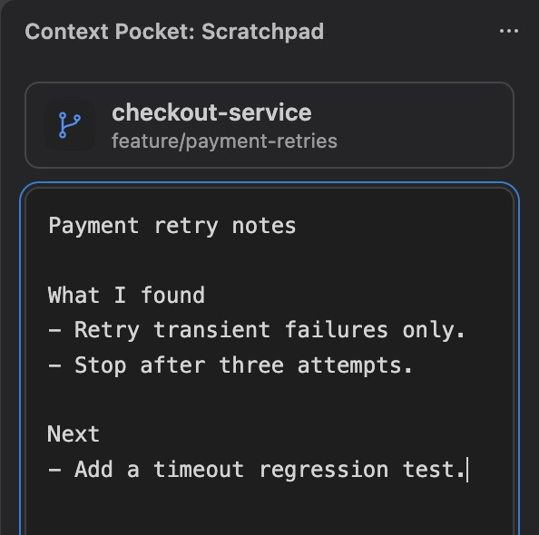

# Context Pocket

**Keep a private scratchpad for each Git branch or project folder in VS Code.**

Before you switch tasks, jot down what you tried, what you learned, and where to pick up. Context Pocket autosaves as you type and brings the note back when you return to that branch or folder.

## Get started

1. Install [Context Pocket from the VS Code Marketplace](https://marketplace.visualstudio.com/items?itemName=chirag4904.context-pocket).
2. Open a folder and select **Context Pocket** in the Activity Bar.
3. Write a note, switch branches, and switch back to see it restored.

You can also open the scratchpad with **Context Pocket: Open Scratchpad** in the Command Palette or by clicking the note icon in the status bar. A dot in the status bar indicates that the current scratchpad has a note.

## How notes follow your work

- **Git repository.** Each branch has its own scratchpad for that local checkout. In a workspace with multiple repositories, the active file helps select the current repository.
- **Project without a Git branch.** The folder gets one scratchpad. When a branch becomes available for that folder, the project note moves to it. If the branch already has a note, the project note is appended.
- **Clear a note.** Select **Clear Current Scratchpad** in the scratchpad’s **…** menu, or run **Context Pocket: Clear Current Scratchpad** from the Command Palette. Confirm to clear the current note.

## Where notes are stored

Context Pocket saves notes in VS Code’s extension storage on the machine running the extension. In a remote session, this may be the remote host. Notes stay outside your repository, so they won’t appear in Git commits. Context Pocket does not sync notes or send their contents to a service.

**Requires VS Code 1.85 or later and a trusted workspace.** Context Pocket uses VS Code’s built-in Git extension.
